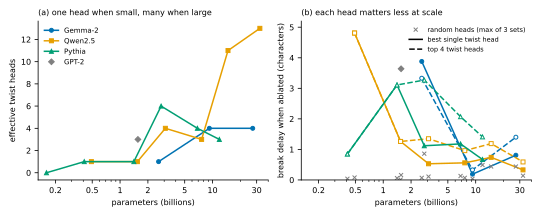
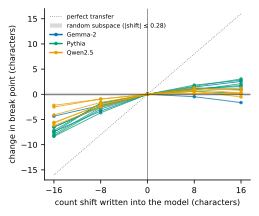
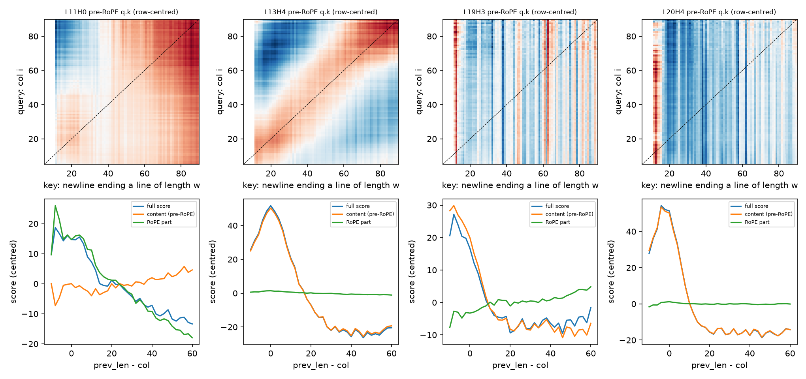

# How open-weight LMs know where to break a line

Language models see tokens, not characters, yet they put line breaks in the right place in fixed-width text. [Gurnee et al. (2025)](https://arxiv.org/abs/2601.04480) showed how Claude 3.5 Haiku does it. The model keeps a running **character count**, and **boundary heads** compare that count to the length of the previous line through their query–key (QK) circuit, a so-called "twist". A boundary head attends to the previous newline when the line is about to overflow.

This repo tests whether **open-weight models** do the same thing, across 16 models from 4 families (Gemma-2, Qwen2.5, Pythia, GPT-2; 0.16B–32B).

## Results

**1. 15 of 16 models have twist heads.** For every attention head we build the matrix of query–key scores between "current character count *i*" and "a newline ending a line of length *w*". A twist head's scores are organised by the offset *w − i*, so they form a diagonal band. Every model has such heads except Pythia-160M, which is also the worst linebreaker (AUC 0.90).

**2. They compare characters, not token positions.** Rotary position embeddings (RoPE) give open models an easy shortcut: estimate the distance to the newline in tokens. The heads don't use it. Across the 57 effective twist heads in the 15 RoPE models, the median share of score variance coming from the RoPE term is 0.5%. GPT-2, which has no RoPE, builds the same heads.

**3. Small models use one head; large models use an ensemble.**



Up to ~2.6B parameters a model has **one** effective twist head, and mean-ablating it delays line breaks by up to ~5 characters (Qwen2.5-0.5B L4H8: 4.8, Gemma-2-2B L13H4: 3.9, Pythia-1.4B L10H3: 3.1). Larger models have 3–13 twist heads tuned to different offsets, the "stereoscopic" ensemble described for Claude. Each one matters much less on its own. Random heads: ≤ 0.9 characters, and ≤ 0.5 in all but one model.

**4. The character count is causal.** We find a 6-dimensional "count" subspace from class means of the residual stream and clamp it to the value for "δ characters earlier". This delays line breaks in all 15 models where clamping is interpretable: −2 to −8 characters for δ = −16. Clamping a random 6-d subspace moves the break point ≤ 0.28 characters.



**5. Gemma-2-2B in detail.** A single head, L13H4, does the comparison. Almost all of its score comes from content: the RoPE part carries 0.3% of the variance. Editing **only L13H4's query** toward "16 fewer characters" delays breaks by 2.7 characters (random edit of the same size: +0.2). Some nearby heads track token distance through RoPE instead, but ablating them has no effect.


*Top: pre-RoPE query·key scores, query = character count, key = newline ending a line of length w. L13H4 shows the diagonal "twist". Bottom: real scores split into content and RoPE parts.*

### What did not work

- **Steering is one-sided.** "Fewer characters" moves breaks reliably; "more characters" barely does. Our unverified guess: col > width never occurs in wrapped training text.
- **Editing the width side fails.** Shifting the newline key toward a wider or a narrower line both delay breaks, so it isn't a clean "width dial".
- **Gemma-2-2B's count is gentler than Claude's.** Its count representation is low-dimensional, but much less curved and rippled than Claude's helix.
- **Clamping breaks GPT-2 XL.** Even a no-op clamp collapses its linebreaking, so steering couldn't be measured there.

### Caveats

- **One run per model, no error bars.**
- **Twist-head criteria are heuristic.** We changed the "effective" rule after seeing that Qwen2.5-0.5B's most important head failed the original score-only rule. Head counts change only for four Qwen models.
- **Random-head controls aren't fully clean.** They don't exclude other weaker twist heads.
- **Qwen models were tested on fewer samples.** Qwen's tokenizer sometimes merges a newline with neighbouring characters. Those samples are skipped, which leaves Qwen with 136 of the 400 requested.

## Setup in one paragraph

Prose from [Pile-10k](https://huggingface.co/datasets/NeelNanda/pile-10k) is re-wrapped greedily at a random width of 20–100 characters, so the rule is exact: break iff `col + 1 + len(next word) > width`. The **break point** is the slack at which P(newline) = 0.5. Effects are measured as shifts in characters on 150 held-out samples. A **twist head** has η²(offset) > 0.5 in its class-mean pre-RoPE score matrix, with a peak slope within ±0.3 of 1. An **effective** twist head also attends to the newline (mean ≥ 0.01), and its score (η² ≥ 0.3) or its attention (η² ≥ 0.1) tracks remaining characters. See `linebreak/mechanism.py`.

## Repo

```
run.py                     one model -> results/raw/<model>.json
linebreak/
  data.py                  wrapped prose + per-token labels (col, width, ...)
  collect.py               one forward pass: P(newline), residuals, attention to last newline
  analyses.py              behaviour, probes, attention head scan
  mechanism.py             twist scan, content/RoPE split, ablation, steering, one-head edits
  experiments.py           drivers for each step
  arch.py                  Gemma/Qwen/Llama, GPT-NeoX (Pythia), GPT-2 adapters
scripts/summarize.py       results/raw -> results/summary.csv, results/steering.csv
scripts/plot.py            -> figures/
results/raw/               per-model results used in this writeup
```

```bash
uv sync
uv run python run.py --model google/gemma-2-2b                       # ~10 min on an 8 GB GPU
uv run python run.py --model Qwen/Qwen2.5-32B --layer-stride 4        # needs ~80 GB
uv run python run.py --model google/gemma-2-2b --steps count,qk,heads,qk_steer --qk-head 13 4
uv run python scripts/summarize.py && uv run python scripts/plot.py
```

Gemma-2-9B/27B were run from the ungated mirrors `unsloth/gemma-2-9b` / `unsloth/gemma-2-27b`. The JSON files in `results/raw/` were produced with an earlier version of this code that also ran extra steps (e.g. additive steering) not kept here. Rerunning reproduces every reported number except the random-control draws.
